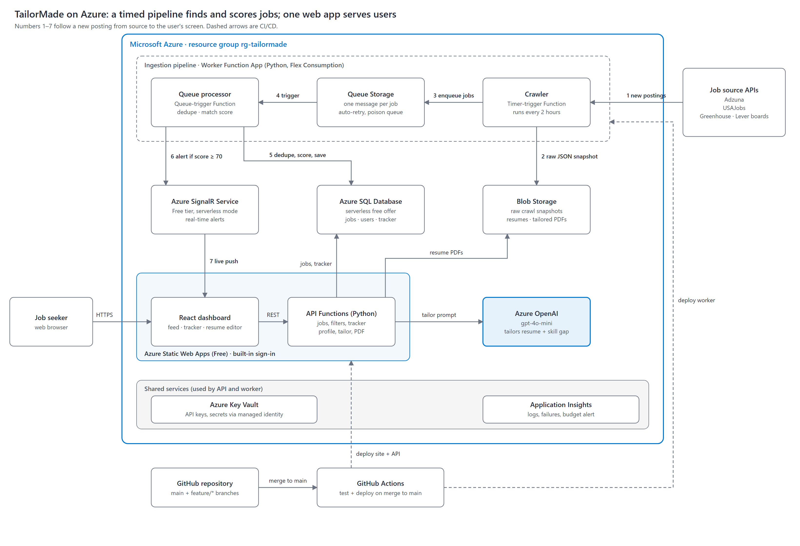

# TailorMade

Find jobs, see how well you fit each one, and send a resume tailored to it, all in one place.

Job seekers bounce between LinkedIn, Handshake, company career pages and spreadsheets, and lose track of what they applied to and which resume they sent. TailorMade pulls postings from public job board APIs into one feed, scores each one against your saved searches, and alerts you live when a strong match appears. On any job you can click **Tailor** to get a resume rewritten for that posting, with a match score and a list of skills the posting asks for that you don't list. The application tracker keeps the exact resume version you sent with each application.

## Features

**In scope this semester**
- Job feed built from Greenhouse, Lever and Adzuna (official APIs only, no scraping)
- Duplicate detection across sources
- Saved filters and a match score for each job
- Live in-app alerts for high matches (Azure SignalR)
- Application tracker board: Saved, Applied, Interview, Offer
- Resume tailoring with Azure OpenAI, exported to PDF and linked to the application

**Future work**
- Browser extension for one-click tracking
- Email digest
- Interview prep notes per application

## Architecture



| Part | Azure service | What it does |
|---|---|---|
| `frontend/` | Static Web Apps (Free) | React dashboard, built-in sign-in |
| `api/` | SWA managed Functions (Python) | Jobs, filters, tracker and tailoring endpoints |
| `worker/` | Function App (Python, Flex Consumption) | Timer crawler every 2 hours, queue processor |
| `db/` | Azure SQL Database (free offer) | Jobs, users, filters, applications, resume versions |
| | Blob Storage | Raw crawl snapshots, uploaded resumes, tailored PDFs |
| | Queue Storage | Hands each crawled job to the processor |
| | SignalR Service (Free) | Pushes live alerts to the dashboard |
| | Azure OpenAI | Resume tailoring and skill-gap analysis |
| | Key Vault, Application Insights | Secrets and monitoring |
| `.github/` | GitHub Actions | Build, test and deploy |

More detail: [docs/architecture.md](docs/architecture.md). The editable diagram is [docs/architecture/tailormade-architecture.drawio](docs/architecture/tailormade-architecture.drawio).

## Repository layout

```
frontend/   React + Vite app
api/        User-facing HTTP API (Azure Functions, Python)
worker/     Crawler and job processor (Azure Functions, Python)
db/         SQL schema
infra/      Bicep templates for Azure resources
docs/       Architecture notes, diagram, branching strategy
.github/    Workflows, PR and issue templates
```

## Team

| Name | Role | Owns |
|---|---|---|
| Johnny Zhu | Backend developer | Worker: crawler, queue processing, dedupe, scoring, live alerts. Azure deployment. |
| Lina Romero | Backend developer | API: jobs and filter endpoints, tracker, resume tailoring |
| Ebulo Mejia | Database developer | Schema, indexes, seed data, filter queries |
| Ayomide Ogunbode | Front-end developer | Job feed, tracker board, resume builder UI, live alerts |
| Joshua Okeke | Researcher | Job source APIs and terms, tailoring prompts, cost estimate, testing |
| Dylan Wu | Flex | CI/CD, infrastructure templates, diagram, presentation |

## Local setup

You need Git, Node.js 20+, Python 3.11+, [Azure Functions Core Tools v4](https://learn.microsoft.com/azure/azure-functions/functions-run-local) and [Azurite](https://learn.microsoft.com/azure/storage/common/storage-use-azurite) (the local storage emulator).

```bash
git clone <repo-url>
cd tailormade
```

**Frontend**
```bash
cd frontend
npm install
npm run dev        # http://localhost:5173
```

**API**
```bash
cd api
python -m venv .venv
.venv/Scripts/activate          # macOS/Linux: source .venv/bin/activate
pip install -r requirements.txt
cp local.settings.example.json local.settings.json
func start                      # http://localhost:7071/api/health
```

**Worker**
```bash
cd worker
python -m venv .venv
.venv/Scripts/activate
pip install -r requirements-dev.txt
cp local.settings.example.json local.settings.json
pytest                          # unit tests
python -m crawler.run           # one crawl, prints what it found
azurite --silent --location .azurite   # in a second terminal
func start                      # runs the timer and queue functions
```

To trigger the crawler without waiting for the timer while `func start` is running:
```bash
curl -X POST http://localhost:7071/admin/functions/crawl_jobs -H "Content-Type: application/json" -d "{}"
```

Secrets (Adzuna key, SQL connection string) go only in `local.settings.json`, which is gitignored. Never commit real keys.

## Branching strategy

- `main` is protected: no direct pushes, every change comes through a pull request with at least one review.
- Branch names: `feature/<name>-<thing>`, for example `feature/johnny-crawler`. Use `fix/` for bug fixes.
- Keep branches short-lived and pull from `main` often.
- Progress is tracked on the GitHub Projects board; link each PR to its issue.

Details: [docs/branching.md](docs/branching.md).
