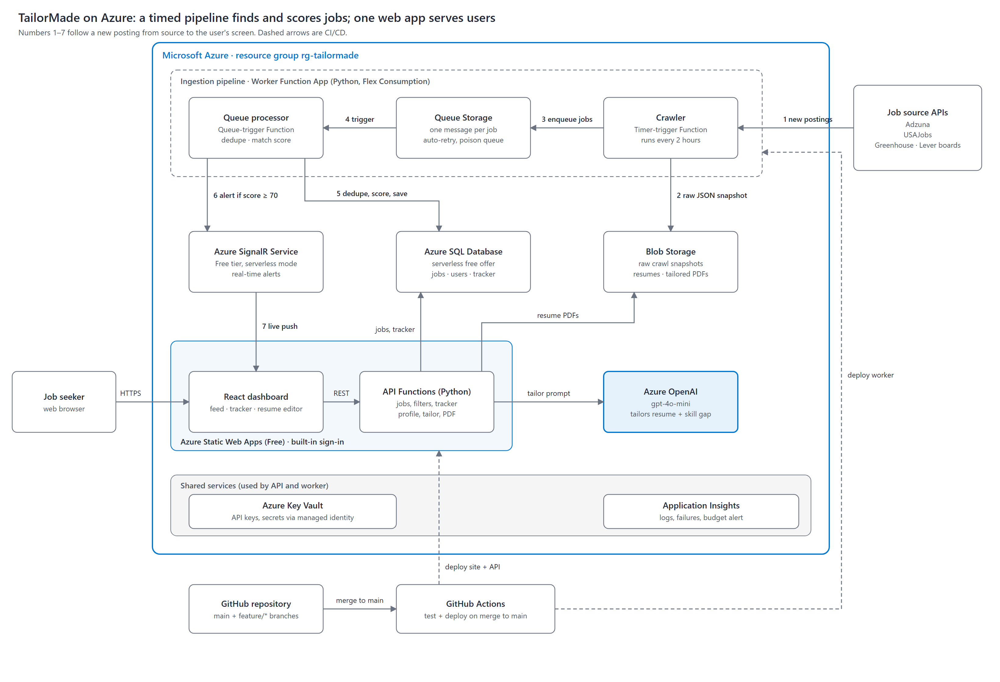

# Architecture

## Following one job through the system

1. **Crawl.** The worker's timer function `crawl_jobs` runs every 2 hours. It calls the Greenhouse and Lever public job board APIs for a configured list of companies, plus Adzuna search when a key is set.
2. **Snapshot.** The raw responses from that run are saved as one JSON file in Blob Storage (`raw-crawls/`). This lets us debug a bad run or replay it without calling the APIs again.
3. **Queue.** Each job is normalized into a common shape and put on the `jobs-to-process` queue as its own message, so one bad posting can't break the whole run and the processor can scale out.
4. **Process.** `process_job` computes the dedupe hash: SHA-256 of normalized company, title and city. The `jobs` table has a UNIQUE index on that hash, so the same posting found on two sites becomes one job with two rows in `job_sources`.
5. **Score and alert.** The job is scored against every user's saved filters. A score of 70 or higher sends a SignalR message, and the dashboard shows a live toast.
6. **Tailor.** In the dashboard the user clicks **Tailor** on a job. The API sends the user's profile and the job description to Azure OpenAI, which returns rewritten resume bullets, a match score and missing skills. The PDF is saved to Blob Storage and a `resume_versions` row links it to the application.

## Why these services

| Choice | Reason |
|---|---|
| Azure Functions (consumption) | We only pay while the crawler or an API call runs. Timer and queue triggers are built in. |
| Static Web Apps (Free) | Hosts the React build, includes managed API functions and sign-in with no extra code. |
| Azure SQL Database (free offer) | Relational data and filter queries; the free offer does not expire after 12 months like the Postgres free tier. |
| Queue Storage | Cheapest Azure queue; enough for our volume. |
| Blob Storage | Raw snapshots, uploaded resumes and generated PDFs. |
| SignalR Service (Free) | Real-time alerts in the browser; replaces SMS based on instructor feedback. |
| Azure OpenAI | Resume tailoring is our differentiator; keeps the whole stack on Azure. |
| Key Vault | Secrets stay out of code and app settings use managed identity. |

## Job sources

We only use official, public APIs. LinkedIn, Glassdoor and Handshake forbid scraping in their terms, so they are out.

| Source | Auth | Notes |
|---|---|---|
| Greenhouse job boards | None | Many tech companies; direct company postings |
| Lever postings | None | Same idea as Greenhouse |
| Adzuna | Free app id and key | Broad search across employers, limited daily calls |

## Estimated monthly cost

| Service | Estimate |
|---|---|
| Static Web Apps (Free) | $0 |
| Functions (consumption free grant) | $0 |
| Azure SQL Database (free offer) | $0 |
| Storage (blobs + queue) | under $1 |
| SignalR Service (Free) | $0 |
| Azure OpenAI (gpt-4o-mini) | $1–4 |
| Key Vault, Application Insights | under $1 |
| **Total** | **about $1–5** |
